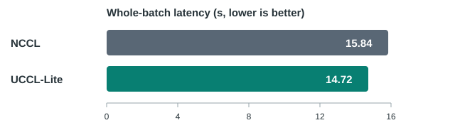

# UCCL Lite NCCL AG/RS/AR compatibility layer

## Best end-to-end result

GLM-4.5-Air-FP8 on 8×NVIDIA L4, SGLang TP8/DP8/EP8. Workload: 64 concurrent
requests, 256 input and 32 output tokens each; 32 running requests maximum.
Three-run median whole-batch latency: **UCCL-Lite 14.72 s vs NCCL 15.84 s
(7.1% lower)**. This workload includes queueing.



This is an experimental **single-node, eight-process, BF16** NCCL compatibility
layer for AllGather, ReduceScatter(SUM), and AllReduce(SUM). It forwards other
NCCL calls used by the installed SGLang PyNccl wrapper to the real NCCL
library. It is not a complete NCCL ABI implementation.

The proxy maps NCCL communicators by unique ID and rank; NCCL still handles
initialization and unsupported operations. Its original data path in
`../../experimental/lite/src/collectives/multiprocess_collectives.cc` uses
whole-tensor GPU/host copies and a CPU callback. It is the fallback when the
packet mode below is disabled.

The experimental packet path in
`../../experimental/lite/src/collectives/multiprocess_packet_ag.cu` uses two
shared, mapped host packet slots and system-scope generation signals. Each
process launches transport on its own GPU stream. AG uses separate GPU upload
and download crews for outputs of at least 512 KiB. RS uses a GPU path for
2–64 KiB inputs; larger RS keeps the destination GPU's own shard on-device,
sums the other seven BF16 contributions on CPU, then adds the retained shard.
Large RS and AR partition work by NUMA group and use two CPU lanes. Separate credits
protect input packets, CPU partials, and result packets from early reuse.
This is a multiprocess implementation of the packet protocol, not the
single-process `PacketPipeline` class used by the standalone benchmark.

Packet mode remains opt-in because performance has been validated only on the
tested 8xL4 host. Three SGLang runs with 32 input and 64 output tokens/request,
TP8/DP8/EP8, and `mem_fraction_static=0.93` gave these medians. The NCCL
baseline is the earlier clean run with the same server flags:

| Batch | Backend | Last TTFT | Batch-tail TPOT | Whole batch |
| ---: | --- | ---: | ---: | ---: |
| 512 | NCCL | 6.05 s | 210.4 ms | 19.34 s |
| 512 | packet | 5.07 s | 210.3 ms | 18.32 s |
| 1024 | NCCL | 11.67 s | 342.5 ms | 33.26 s |
| 1024 | packet | 10.21 s | 340.5 ms | 31.69 s |

For 64 output tokens, batch-tail TPOT at batch sizes 1/2/4/8/16 was
152.1/157.1/159.7/151.5/148.7 ms with the packet proxy, versus
162.2/165.5/169.4/163.3/150.1 ms with NCCL. Batch size 16 uses fresh
ten-run medians; batch size 1 uses a fresh five-run NCCL check; the other
values use three runs. Batch-size-16 TTFT was 0.474 s for both backends in
the ten-run check. For one output token, last TTFT at batch sizes
16/64/128/256/512/1024 was 0.495/0.793/1.430/2.626/5.142/10.254 s with
the packet proxy, versus 0.505/0.901/1.640/3.112/6.055/11.945 s with
NCCL. Batch size 16 uses ten repeated calls because its TTFT was bimodal;
the other prefill values use three runs.

Batch-tail TPOT is `(whole-batch latency - last TTFT) / 63`. Request-level
tracing confirmed AG=2889, RS=2880, and AR=883 intercepted calls for a
completed bs=512 request batch. Those trace logs were excluded from latency
measurement. Five-repeat BF16 microbenchmarks covered AG/RS/AR from 1 KiB to
32 MiB on the same host. Each point used 20 warmups, 60 timed calls per
repeat, and the median of the five maximum-rank medians. At 32 MiB, packet
AG/RS/AR measured 5.24/5.28/8.95 ms, versus 5.45/5.55/9.03 ms for the
standalone router. The standalone benchmark owns all GPUs in one process;
the proxy uses eight processes. These measurements do not establish
performance equivalence on other hosts, CUDA versions, or call patterns.
The [48-point CSV](perf_8l4_20261112.csv) contains every measured size.
Both curves use one fixed size-adaptive configuration, rather than selecting
the best separately measured variant at each point.

### Additional end-to-end workloads (2026-11-12)

The same GLM-4.5-Air-FP8 TP8/DP8/EP8 server was measured with longer prompts
and responses. Each case is `requests:input tokens:output tokens`; each value
is the median of three completed runs. The client submits all requests
concurrently to `/generate` and records streaming token timestamps. Both
backends use the same prompts, `mem_fraction_static=0.93`, eager execution,
disabled radix cache, `max_running_requests=32`, and the same CPU affinity.
For NCCL, the same compatibility library is loaded with
`UCCL_LITE_NCCL_ENABLE=0`. An 8-request warmup was run after each server start.

| Requests:input:output | Last TTFT packet / NCCL | Batch-tail TPOT packet / NCCL | Whole batch packet / NCCL | Whole-batch gain |
| --- | ---: | ---: | ---: | ---: |
| 32:128:128 | 1.450 / 1.657 s | 149.5 / 152.0 ms | 20.429 / 20.960 s | 2.5% |
| 16:512:64 | 2.654 / 3.118 s | 152.0 / 151.5 ms | 12.238 / 12.670 s | 3.4% |
| 32:512:64 | 5.072 / 6.050 s | 153.3 / 151.5 ms | 14.752 / 15.592 s | 5.4% |
| 8:64:256 | 0.475 / 0.476 s | 146.5 / 149.3 ms | 37.825 / 38.546 s | 1.9% |
| 32:64:256 | 0.854 / 0.944 s | 152.5 / 154.1 ms | 39.743 / 40.226 s | 1.2% |
| 64:256:32 | 9.977 / 11.028 s | 152.0 / 155.4 ms | 14.722 / 15.843 s | 7.1% |

The 64-request case includes queueing because the server allows at most 32
running requests. It is an overload comparison, not a pure collective-latency
measurement. The prompts are synthetic incident-summary text repeated to reach
the requested lengths, so these results establish performance for the listed
shapes, not for a production prompt distribution. The two 512-token input
cases have slightly better batch-tail TPOT with NCCL even though packet mode
has lower TTFT and whole-batch time. The [raw 36-run CSV](e2e_workloads_20261112.csv)
and [client](bench_e2e_workloads.py) are provided for reproduction. `batch_tail_tpot_ms`
is `(last completion - last first token) / (output tokens - 1)`; the CSV also
contains median per-request TTFT and TPOT.

### BurstGPT trace replay (2026-11-12)

We replayed three 60-second windows from the public
[BurstGPT_1.csv trace](https://github.com/HPMLL/BurstGPT/blob/main/data/BurstGPT_1.csv).
The windows are identified by `floor(Timestamp / 60)` in that file. We kept
every successful ChatGPT request in each selected window, preserving the
original second-level arrival time and request/response token counts. No
time scaling, token clipping, or request subsampling was applied within a
window. All selected requests fit the configured 4096-token context.

BurstGPT does not publish prompt content. For this replay, we used human
messages from the first 10 MiB of the public
[ShareGPT file](https://huggingface.co/datasets/anon8231489123/ShareGPT_Vicuna_unfiltered/blob/main/ShareGPT_V3_unfiltered_cleaned_split.json),
tokenized them with the GLM tokenizer, and selected a sufficiently long
message for each request before trimming it to the trace's exact input token
count. Thus arrival times and lengths come from the real trace, and prompt
texts are real but come from a separate corpus. Original BurstGPT prompt
content and its correlation with length or arrival time cannot be recovered.

The server used the same GLM-4.5-Air-FP8 TP8/DP8/EP8 eager configuration,
`mem_fraction_static=0.93`, disabled radix cache, and at most 32 running
requests. Both backends loaded the same proxy; NCCL used
`UCCL_LITE_NCCL_ENABLE=0`. Each backend received an 8-request warmup after
startup. The table is the median of three full replays per window. TTFT,
TPOT, and E2E are request-level metrics; makespan is time from the window's
start until its final request finishes.

| Window; requests; median input/output | p50 TTFT packet / NCCL | p95 TTFT packet / NCCL | p50 TPOT packet / NCCL | p50 E2E packet / NCCL | Makespan packet / NCCL |
| --- | ---: | ---: | ---: | ---: | ---: |
| 9242; 50; 508/45 | 0.648 / 0.638 s | 0.831 / 0.831 s | 152.4 / 152.7 ms | 7.440 / 7.529 s | 66.22 / 66.30 s |
| 14622; 112; 112/125 | 4.342 / 4.682 s | 13.419 / 13.929 s | 154.2 / 155.4 ms | 23.708 / 24.005 s | 97.05 / 93.91 s |
| 16738; 31; 1580/108 | 1.530 / 1.625 s | 2.137 / 2.309 s | 178.2 / 185.0 ms | 20.637 / 21.779 s | 104.24 / 106.00 s |

The 50-request window is effectively tied. In the 112-request burst,
packet mode improves p50 TTFT by 7.3% and p50 E2E by 1.2%, while NCCL
finishes the final request 3.3% sooner. In the 31-request long-input
window, packet mode improves p50 TTFT by 5.9%, p50 TPOT by 3.7%, and p50
E2E by 5.2%. The replay client's maximum dispatch lag was below 4 ms in
all runs. The [selected trace rows](burstgpt_windows_20261112.tsv),
[18-run result file](burstgpt_trace_results_20261112.tsv), and
[replay client](bench_burstgpt_trace.py) retain the underlying measurements.

To reproduce the prompt corpus prefix, fetch bytes `0-10485759` from the
linked ShareGPT JSON file. SHA-256 of that prefix is
`d714b39acc25514875b65866e6ba91750518c75926f16502a74f9e62b7202c48`.
SHA-256 of `BurstGPT_1.csv` used here is
`46fc9480ef0b748ecb2b51d512ff08c196b031782cbe6f78e28044d768e86d5a`.
The first two windows were replayed in one client invocation, and window
16738 in a separate invocation, with `--minutes 16738`. Use the same two
invocations for each backend; the deterministic prompt selection depends on
the order of windows in an invocation.

## Build and checks

```bash
make -C integration/nccl_lite
make -C integration/nccl_lite check
make -C integration/nccl_lite check-torch
make -C integration/nccl_lite check-shared-packet
```

Set `CUDA_HOME` and `NCCL_HOME` to the CUDA and NCCL header installations if
they differ from `/usr/local/cuda` and `/usr`. Set `REAL_NCCL` to an absolute
path when `libnccl.so.2` is not on the dynamic loader search path. Set
`TORCHRUN` if PyTorch's launcher is not on `PATH`.
The 8xL4 measurements above used CUDA 12.9 and NCCL 2.28.9; build the proxy
with those versions to reproduce them. The generic Makefile defaults are not
part of the measured configuration.
`check` runs an eight-process C++ AG/RS/AR correctness test. `check-torch` verifies
that `LD_PRELOAD` intercepts PyTorch's NCCL ProcessGroup calls, including the
`ncclCommInitRankConfig` path. Both require eight idle GPUs. Generated files
stay under `integration/nccl_lite/build/`.
Run `check` and `check-torch` through `run_packet_8l4.sh` to exercise packet
mode; the plain commands above exercise the compatibility layer's default
path. For the reported size curve, run `bench_torch.py` through the wrapper
with eight ranks, `UCCL_BENCH_WARMUP=20`, `UCCL_BENCH_ITERS=60`, and
`UCCL_BENCH_REPEATS=5`.
The C++ check also queues mixed AG/RS/AR calls, including 32 MiB AG, 16 MiB
RS, and 1/16 MiB AR, before
synchronizing to exercise shared-buffer lifetime. `check-shared-packet`
validates shared pinned memory and GPU/system generation signals across eight
CUDA processes.

## Use with SGLang

Set both variables before launching the server and its worker processes:

```bash
export LD_PRELOAD="$PWD/integration/nccl_lite/build/libuccl_lite_nccl_compat.so"
export SGLANG_NCCL_SO_PATH="$LD_PRELOAD"
export UCCL_LITE_NCCL_ENABLE=1
export UCCL_LITE_NCCL_MAX_BYTES=33554432
export UCCL_LITE_REAL_NCCL=/path/to/the/real/libnccl.so.2
```

For the tested 8xL4 packet setup, add these variables before starting
SGLang. The CPU lists assign one packet worker and one optional AR lane to
each GPU's NUMA-local physical cores. The isolation setting reserves the
packet worker core from other threads in its rank process.

```bash
export UCCL_LITE_MP_PACKET_AG=1
export UCCL_LITE_MP_PACKET_AG_PIPELINE=1
export UCCL_LITE_MP_PACKET_RS=1
export UCCL_LITE_MP_PACKET_RS_CPU=1
export UCCL_LITE_MP_PACKET_RS_GPU_MAX_BYTES=65536
export UCCL_LITE_MP_PACKET_RS_RETAIN=1
export UCCL_LITE_MP_PACKET_AR=1
export UCCL_LITE_MP_PACKET_AR_GPU_MAX_BYTES=16384
export UCCL_LITE_MP_PACKET_SPLIT_CREDITS=1
export UCCL_LITE_MP_PACKET_SCRATCH=1
export UCCL_LITE_MP_PACKET_HIERARCHICAL=1
export UCCL_LITE_MP_PACKET_HIERARCHICAL_RS=1
export UCCL_LITE_MP_PACKET_PARALLEL_AR=1
export UCCL_LITE_MP_BIND_PACKET_NUMA=1
export UCCL_LITE_MP_PACKET_SPIN=0
export UCCL_LITE_MP_PACKET_WORKER_CPUS=5,11,17,23,29,35,41,47
export UCCL_LITE_MP_PACKET_HELPER_CPUS=4,10,16,22,28,34,40,46
export UCCL_LITE_MP_ISOLATE_PACKET_WORKER=1
export SGLANG_SET_CPU_AFFINITY=1
```

`run_packet_8l4.sh COMMAND [ARGS...]` sets the tested packet variables and
executes `COMMAND` with the proxy preloaded. Set `UCCL_LITE_REAL_NCCL` to
the installed real `libnccl.so.2` before using the wrapper if that library
is not on the loader's default search path. The wrapper changes no SGLang
source or model weights.

AR inputs up to 16 KiB use the small GPU path. AR uses flat CPU reduction
below 16 MiB and NUMA hierarchical reduction at 16 MiB and above. RS inputs
from 2 to 64 KiB use the GPU path; RS at 16 MiB and above uses NUMA-local
partials. The second CPU lane activates for aligned AR inputs of at least
1 MiB per rank and large RS. Run `bench_torch.py` with eight processes to compare the actual message
sizes and verify every result. The launch environment must be identical at
all ranks. `UCCL_LITE_MP_PACKET_PROFILE` and `UCCL_LITE_NCCL_TRACE` add
diagnostic overhead and should stay unset in timed runs.

`LD_PRELOAD` reaches PyTorch ProcessGroup NCCL calls. `SGLANG_NCCL_SO_PATH`
reaches SGLang's ctypes based PyNccl wrapper. The proxy logs the first
intercepted AG, RS, and AR per communicator and rank. If these messages are absent,
the benchmark is measuring NCCL. Set `UCCL_LITE_NCCL_ENABLE=0` to pass through
all operations while keeping the same library loaded.

For request-level verification, set `UCCL_LITE_NCCL_TRACE=1` before launch.
It logs every successfully enqueued AG, RS, and AR call for rank 0, including
per-communicator cumulative counters. Record the counters after server warmup,
send one request batch at a time, and compare the counters after each response.
Tracing adds logging overhead, so disable it for latency measurements.

For the legacy callback path, `UCCL_LITE_MP_CALLBACK_CPUS=5,11,17,23,29,35,41,47`
optionally maps CUDA device indices 0 through 7 to one CPU each.
It is unset by default. The callback changes only its own thread's affinity;
application scheduler threads need a separate affinity setting. On the tested
eight-L4 host, SGLang's `SGLANG_SET_CPU_AFFINITY=1` improved the legacy
proxy's large-batch latency, while reserving one physical core per callback
made it slower. Packet worker isolation uses a separate setting above.

In the validated eager SGLang setup, DP attention padding depends on the
active batch. Request-level tracing confirmed AG/RS during both prefill and
decode at batch size 8; smaller batches can take a different path. Check
request-level counters for every workload before attributing latency to this
proxy.

## Supported call boundary

- Eight ranks, one GPU per process, one fixed CUDA stream per communicator.
- BF16, equal per-rank counts, out-of-place AG and RS SUM, and in-place or
  out-of-place AR SUM. Maximum complete input/output bytes per rank are
  controlled by `UCCL_LITE_NCCL_MAX_BYTES`.
- Calls within `ncclGroupStart`/`ncclGroupEnd`, other datatypes, operations,
  rank counts, and oversized messages pass to NCCL **before enqueue**.
- CUDA Graph capture, variable-size gather/scatter, multi-node routing, and
  generic concurrent streams are outside this boundary.
- Large packet RS sums seven contributions in FP32, rounds to BF16, then adds
  the retained local BF16 contribution and rounds again. Small GPU RS sums
  all eight contributions in FP32 before rounding. Hierarchical RS and AR
  round NUMA-local partials before merging. Results can differ from NCCL's
  reduction tree by one or more BF16 ulps.

The shared-memory rendezvous times out after 60 seconds and aborts all work on
a failed rank rather than publishing stale output. The last successful rank
to join unlinks the shared-memory name immediately; active mappings remain
valid until the processes exit. A crash before all ranks join can leave an
orphan under `/dev/shm/uccl-lite-mp-*`.
Packet mode uses the small-AR and parallel-AR thresholds shown above; the
legacy callback path remains available when packet mode is unset. Benchmark
results should identify which calls were intercepted and retain NCCL controls.
